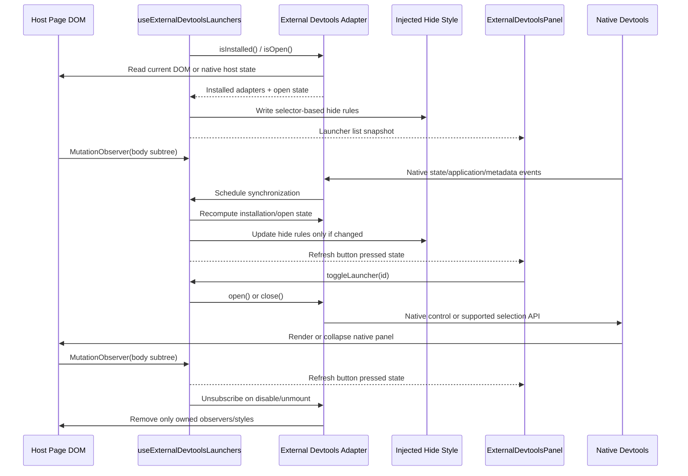

# External devtools internals

Contributor reference for the third-party devtools integrations in the injected toolbar: how host-mounted launchers are aggregated, how the Redux inspector is owned and the upstream contracts each integration is pinned to. User setup, tested versions, and limitations live in the public pages under `packages/docs/src/content/docs/integrations/`.

Host-mounted integrations (TanStack Query, Router, and unified shell; React Hook Form; Jotai; Vue) proxy native controls and hide only launcher chrome; the host library keeps its panels. The Redux integration opens the upstream browser inspector in a separate owned window and connects explicitly registered stores through upstream's public custom-transport seam.

## Architecture flow

## Host-mounted aggregation

Source: `packages/devhost-ui/src/devtools/features/externalDevtoolsPanel/`.

### Adapter-owned host knowledge

Each supported tool is modeled as an `IExternalDevtoolsAdapter`. `externalDevtoolsDetectors.ts` registers the Query, Router, and unified TanStack shell adapters; the Form and Jotai detectors discover one adapter per mounted native inspector. `createVueDevtoolsDetector.ts` observes the Vue/Vite host. The `reduxDevtools` feature detector observes explicit host registrations and its own native browser window and channel. `createExternalDevtoolsDetector.ts` combines current adapters and exposes an owned subscription and disposer to the generic hook. The hook resolves a launcher ID against current adapters before dispatching an action. Form and Jotai encounter identities stay local to the detector session across effect cleanup and re-subscription.

- `isInstalled()` answers whether the host page appears to have mounted the tool.
- `isOpen()` answers whether the native panel is expanded.
- `open()` and `close()` proxy native controls or supported native selection APIs.
- `hideSelectors` lists the host selectors whose launcher chrome is hidden while devhost aggregates that tool.

Host-specific selectors and behavior stay in the adapters, not in the panel component or the hook.

### Selector-based suppression

The feature does not remove host-owned nodes or keep references to launcher elements. `useExternalDevtoolsLaunchers.ts` writes one scoped `<style>` tag into `document.head` with `display: none !important` rules derived from the installed adapters. This survives React or library DOM replacement, collapsed/expanded launcher transitions, and re-renders that recreate native launchers. The native panel DOM stays untouched.

Vue 9's launcher is inside the upstream dock's open ShadowRoot, which a document stylesheet cannot reach. Its detector owns a constructed `CSSStyleSheet` adopted into that root. It targets only native dock-entry launcher markup with the unique current Vue entry title, covering floating and edge layouts, and does not hide the dock, panel, or iframe. Cleanup removes only that sheet from the current list, preserving existing and later foreign sheets. See the [adoptedStyleSheets contract](https://developer.mozilla.org/en-US/docs/Web/API/ShadowRoot/adoptedStyleSheets).

### Mutation observation and loop prevention

The hook observes `document.body` for subtree changes and recomputes installed launchers when the host UI changes. It avoids a full-document watch and batches recomputation behind `requestAnimationFrame`. It observes native open-state attributes, including the unified shell's `data-open`. The hide-style text is rewritten only when the selector set changes, so the feature does not react to its own style updates and lock the page.

Body observation cannot see shadow-tree mutations. The Vue feature separately subscribes to published native panel, connection, trust, application, and dock shared-state events, and observes its native shadow roots for launcher replacement and title changes. Generation checks discard asynchronous responses after context replacement or cleanup. Disable, unmount, and React development StrictMode cleanup release these resources; re-enable and remount subscribe to the current host again.

### UI contract

`ExternalDevtoolsPanel.tsx` only renders the aggregated buttons and each launcher's `isOpen` state. Active buttons use the primary button styling, inactive ones the secondary styling, and every click flows through `toggleLauncher(id)` in the hook. Adapters own the imperative host interactions.

### Safety boundaries

Host-mounted aggregation is scoped to launchers, not panels. devhost may hide supported native launcher controls and proxy open/close through native controls. It must not reparent, restyle wholesale, or take ownership of native panel contents. This keeps the integration low-risk when a page includes several unrelated third-party toolbars.

## TanStack

- Discovery requires an attached native root containing both its persistent panel and native open trigger. A collapsed panel stays mounted; devhost reads `data-open` rather than treating presence as open. Actions re-query current roots and click native open/close controls.
- Standalone Query and Router adapters ignore elements inside the unified shell root (`[data-testid="tanstack_devtools"]`), so their plugins do not create duplicate entries.
- Only the shell's native opening and closing chrome is suppressed. Replacement triggers stay suppressed while aggregation is enabled; disabling or unmounting removes the style without changing panel state.
- Multiple attached shells share upstream events and preferences; the single **TanStack** entry proxies the upstream shared toggle and assigns no shell identities. Browser tests verify that opening a shell on `127.0.0.1` leaves the shell on `localhost` closed. devhost does not rewrite upstream channels or storage.
- devhost does not proxy controls into detached documents; it rediscovers the shell when the popup closes.
- The tested shell uses its default browser event bus; devhost creates no server connection.
- These packages select native event clients only with `NODE_ENV=development`. Storybook browser checks run `NODE_ENV=development bun vitest run -c vitest.storybook.config.ts`; Vite's mode alone does not select that runtime. A test-mode browser probe confirms that Pacer devtools 0.9.1's React `/production` entry, which still imports the base core, renders no pane outside development.
- Table's fixture uses `rowSelectionFeature` and verifies live selected rows in both native state views.

## React Hook Form

- Panel identities are stored in a hook-local `WeakMap` without modifying host attributes or retaining native launcher elements. Actions re-query live panels by identity; a removed identity cannot target its replacement.
- Detection of the 4.4.0 panel, which stays mounted while collapsed, requires its React Hook Form header, native close control, field filter, and field expansion control together.
- Opening clicks the panel's sibling logo SVG, where 4.4.0 installs its native handler; closing clicks its native close button. Only native open buttons containing the logo are suppressed.
- Pinned upstream: [panel lifecycle](https://github.com/react-hook-form/devtools/blob/0486f0e6dd73a203600fc00611aebb6ac79b6e07/src/devToolUI.tsx), [open handler](https://github.com/react-hook-form/devtools/blob/0486f0e6dd73a203600fc00611aebb6ac79b6e07/src/logo.tsx), [close control](https://github.com/react-hook-form/devtools/blob/0486f0e6dd73a203600fc00611aebb6ac79b6e07/src/header.tsx).

## Jotai

- The native root persists while its launcher and shell replace one another. Detection matches the compound native launcher signature, or the native shell with its minimize control and Atom Viewer/Time travel tabs.
- Actions re-query roots and controls; only root identities are kept, in a `WeakMap`. Upstream uses fixed root and shell IDs and shared local-storage preferences; devhost scopes actions to individual roots despite the duplicate IDs and does not rewrite IDs or storage.
- The documented 0.14.0 setup runs on the workspace's React 19 in the toolbar browser regressions: custom stores, live atom values, snapshot recording, manual restoration, timed playback, multiple stores, and remount/removal.
- The repository's toolbar browser regressions run with the workspace React 19 and cover live atoms, history, restoration, playback, multiple stores, and suppression cleanup. React 19 is a tested runtime observation, not upstream peer support.
- The [0.14.0 release](https://github.com/jotaijs/jotai-devtools/releases/tag/v0.14.0) was published on May 8, 2026 and declares peers `jotai >=2.20.0` and `react >=17.0.0`. 0.15.0 declares `dist/index.d.mts` as its root type export but ships `dist/index.d.ts`; devhost supplies no declaration shim or package patch for it.
- `patches/jotai-devtools@0.14.0.patch` removes the development tree-shaking notice for Storybook only; see `packages/devhost-ui/AGENTS.md`.
- Pinned upstream: [provider and root lifecycle](https://github.com/jotaijs/jotai-devtools/blob/1de78d7536d5d2e1dd97bb2a9e66bd10a76fc068/src/DevTools/DevTools.tsx), [shell](https://github.com/jotaijs/jotai-devtools/blob/1de78d7536d5d2e1dd97bb2a9e66bd10a76fc068/src/DevTools/Extension/components/Shell/Shell.tsx), [snapshot restoration](https://github.com/jotaijs/jotai-devtools/blob/1de78d7536d5d2e1dd97bb2a9e66bd10a76fc068/src/DevTools/Extension/components/Shell/components/TimeTravel/components/SnapshotDetail/components/DisplaySnapshotDetails/components/SnapshotActions.tsx).

## Vue

- The detector uses the published `getDevframeClientContext()` from `@devframes/hub/client`, the getter the tested host uses. Kit 0.7.6's `getDevToolsClientContext()` reads a different global and returns `undefined` in this host; devhost supplies no alias or fabricated context. Vue's runtime kit supplies application snapshots and lifecycle events. devhost reads these objects without installing or disposing the host's kit or hooks.
- Open and close call native `docks.switchEntry("vue-devtools")` and `docks.switchEntry(null)`. Pressed state requires native panel state **open** and selected dock **vue-devtools**.
- The suppression sheet follows the current entry title, native root replacement, and floating/edge layout changes. Server metadata replacement, field removal, entry removal and re-registration, client overrides, and later forced client registration stay upstream-owned. Cleanup restores launcher visibility without reverting metadata, disposing registrations, changing the selected panel, or removing foreign sheets.
- Shared-state observation starts only when the host is trusted and `devframe:docks` already exists in its published cache. In devframe 1.2.2, requesting a missing state before authorization creates a deferred state object, and initializing a competing object can leave the native UI with stale metadata. devhost never initializes that registry, overrides native listeners, or claims registration ownership. Async subscriptions and application queries carry generation checks so cleanup cannot install a late listener or sheet.
- Runtime state stays local to the host document and active detector; the detector shares no global project port or browser session.
- Native browser regressions cover Components, live state, page selection, normal/passive/hidden hosts, unrelated pages, application mount/unmount, metadata replacement, title collision and recovery, native root/layout replacement, foreign sheets, and devhost disable/unmount/remount. Independent host servers on separate origins, including a `/project-b/` Vite base, keep separate state and selection.
- Compiled-bundle validation runs two devhost projects through separate public HTTP/HTTPS hostnames, including the Vite base path, native authorization, live Components state, and independent selection with `proxyLocalOrigin = true`. The fixture's manually rendered toolbar is removed for that check. The isolated Caddy uses test-only `skip_install_trust`, `http_port`, and `https_port` globals and a private browser that accepts its untrusted certificate. This proves routing, injection, and inspection, not managed CA trust installation. No test override changes the app generator or the Vue host contract.
- Pinned upstream: [Vue host client and instrumentation](https://github.com/vuejs/devtools/blob/e69a502d2a800da79ded86cb9847b2bcb922aec5/packages/vite/src/client.ts), [hub getter](https://github.com/devframes/devframe/blob/56caf88d5498e60b46904441d20d28b533886d99/packages/hub/src/client/context.ts), [dock APIs](https://github.com/devframes/devframe/blob/56caf88d5498e60b46904441d20d28b533886d99/packages/hub/src/client/docks.ts), [native launcher markup](https://github.com/devframes/devframe/blob/56caf88d5498e60b46904441d20d28b533886d99/packages/hub-ui/src/client/components/dock/DockEntry.vue).

## Redux Toolkit and Zustand

Source: `packages/devhost-ui/src/devtools/features/reduxDevtools/` and `apps/devhost/internal/devtools/redux_assets.go`.

### Inspector and assets

- The popup uses the public upstream App unchanged. It owns its panel layout and Emotion styles in its own document; no inspector stylesheet or font reaches the host page. devhost owns only explicit producer registration, transport, setup feedback, and the popup's lifecycle.
- The compiled Go app serves the registration module (`/__devhost__/redux.js`), inspector module, and emitted inspector stylesheet. Unversioned production module and style requests redirect to content-versioned URLs with one-year immutable caching; source-checkout requests stay uncached and rebuild the requested asset. Failed source builds return HTTP 503.
- Inside this repository the typed source export is `@alexgorbatchev/devhost-ui/redux`. The served module does not require publishing or installing the private UI package.

### Upstream contract

- Frontend: `@redux-devtools/app-core` 3.0.0 App with its caller-owned Redux store and custom transport, public `@redux-devtools/app` 8.0.0 `nonReduxDispatch`, React Redux 9.2.0, Redux 5.0.1, and Emotion 11.14.0/11.14.1, on the workspace React 19.
- Host tests: Redux Toolkit 2.13.0, instrument 3.0.0, Zustand 5.0.15 with its unchanged devtools middleware, and browser extension 3.2.10 where installed.
- Boundaries: the [app-core transport/store seam](https://github.com/reduxjs/redux-devtools/blob/89ae6ee57c6879c0da39d1f03d6ad8de029c5390/packages/redux-devtools-app-core/README.md), [non-Redux wire protocol](https://github.com/reduxjs/redux-devtools/blob/89ae6ee57c6879c0da39d1f03d6ad8de029c5390/docs/Integrations/Remote.md), [instrument EnhancedStore contract](https://github.com/reduxjs/redux-devtools/blob/89ae6ee57c6879c0da39d1f03d6ad8de029c5390/packages/redux-devtools-instrument/src/instrument.ts), and [Zustand StoreApi](https://github.com/pmndrs/zustand/blob/v5.0.15/src/vanilla.ts). The registration functions are devhost APIs around those capabilities, not upstream registrars or discovery of private extension sessions.

### Stores, history, and serialization

- For an extension-instrumented Toolkit store, devhost checks `liftedStore.getState/subscribe/dispatch` and lifted history before using it. Extension wrapper typings advertise a bare StoreEnhancer, so arbitrary extension versions are not guaranteed. A plain store is never replaced or recreated.
- Toolkit uses the same lifted store for native jump/playback, reset, revert, commit, skip/sweep, reorder, lock, pause, export, and imported lifted history, and reads the existing lifted history on attachment and reload. Zustand's unsupported optional controls are disabled through upstream feature configuration. Zustand's public subscription does not expose private middleware action labels or earlier native history.
- Upstream JSAN 3.1.14 serialization carries projected data over `MessageChannel` as strings. Snapshot or replay errors produce setup feedback without replacing host actions or throwing through an ordinary host state update.

### Sessions and cleanup

- Every registration has a unique native connection ID. Re-registering a stable host ID replaces its producer; an older unregister handle cannot remove the replacement.
- Disabling aggregation, unmounting, or host navigation closes the owned monitor, channels, timer, and producer subscriptions, and preserves host stores, native middleware, extension hooks and listeners, and other tools. StrictMode cleanup/re-subscription and remount recovery use the same registration state. Reloading a monitor exchanges a fresh channel; browser closure and the owned close watcher reclaim it before reopening.
- Navigating directly to the monitor shows setup guidance with no connected hosts.
- Concurrent projects use their own routed origins, host windows, registrations, monitor windows, and channels. Tests run two devhost instances through native Caddy, including HTTPS and an app page under `/project-b/`; reserved control and module URLs stay at the origin root. That validation uses isolated Caddy storage, allocated listener and admin ports, `skip_install_trust`, and an owned browser that ignores the fixture certificate. It proves routing, shipped injection and assets, and store connectivity, not system trust installation.

### Installed-extension coexistence

- devhost neither overwrites the extension's hook or listeners nor calls shared disconnect or middleware cleanup; the extension keeps recording and replaying before, during, and after attachment.
- Each upstream monitor keeps its own cursor: the released [pageScript handler](https://github.com/reduxjs/redux-devtools/blob/1c5df1ee3275612c34e8ad37dd58537c83d5e885/extension/src/pageScript/index.ts) omits broadcast while time traveling, paused, or locked.
- Cold Zustand metadata and history in the extension can be incomplete when its frontend opens after stores were created, also with aggregation disabled. The tested coexistence sequence opens the empty extension frontend first, then creates the stores. devhost does not repair upstream cold history or enumerate private sessions.
