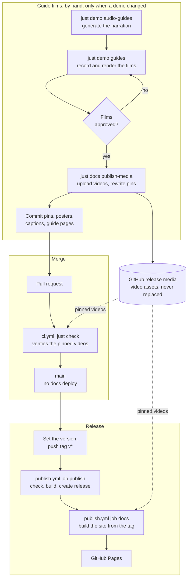

A `devhost` release publishes two things from one Git tag: the binaries and this documentation site. The site is deployed only by a release, so it describes the released version and not unreleased work on `main`.

The guide videos and the promo on the landing page follow a separate, manual track. No workflow records or renders video. A release downloads the videos that were published earlier and checks each against the hash pinned in the repository.

## Pipeline

The diagram has three stages. The films are made and published by hand, and only when a demo changed. A merge to `main` runs the checks and deploys nothing. A `v*` tag publishes the binaries and then the site. The dotted arrows are the pinned videos, which every docs build downloads from the `media` release.

## How it works

### Binaries

Pushing a tag such as `v0.0.2` starts `.github/workflows/publish.yml`. The workflow fails unless the tag matches the version in `apps/devhost/metadata.json`. It runs `just check`, builds the release archives, creates the GitHub release for the tag, and uploads the archives to it.

### Documentation site

The `docs` job of the same workflow runs after the release exists. It calls `.github/workflows/docs.yml`, which checks out the tag, builds `packages/docs`, and deploys the result to GitHub Pages. A failed release deploys nothing.

A push to `main` does not deploy the site. Documentation merged to `main` is published with the next release. A correction to the documentation is published the same way, with the next release.

The `github-pages` environment accepts deployments only from `main` and from tags that match `v*`. The `Deploy docs to GitHub Pages` workflow can also be run by hand, within those limits: a run from a release tag deploys that release's documentation again, unchanged, and a run from `main` deploys everything on `main`, including documentation of unreleased behavior. A branch that holds only a correction cannot be deployed.

### Guide videos

The videos are assets of a GitHub release named `media`, not files in the repository. `packages/docs/demo-media.json` pins each one by name, release asset, SHA-256, and size. Every docs build downloads the pinned videos and rejects a file whose hash differs.

A tag carries its pins. The site built for a release therefore shows the videos that were pinned in the tagged commit, and an asset is never replaced, so an earlier tag still builds with the videos it pinned.

New videos need a Linux host with the recording tools, a coding-agent request, an ElevenLabs key, and a review of the result. For that reason they are made by hand before the release:

1. `just demo audio-guides` generates the narration of changed lines.
2. `just demo guides` records each guide and renders its film. `just demo record` does the same for the promo.
3. After the films are reviewed, `just docs publish-media` uploads them and rewrites their pins.
4. The pins, posters, captions, and guide pages are committed together.

A change to the interface does not update a video. When a release changes what a guide shows, the film has to be recorded again before the tag is pushed; otherwise the release ships the earlier video beside the new text.
