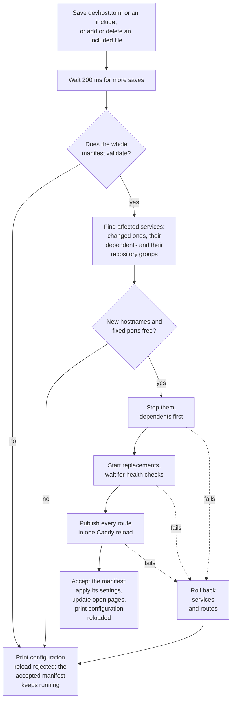

While a stack runs, saving `devhost.toml` or any included manifest applies the change without restarting devhost. Only the services the edit affects restart, and an invalid edit leaves the stack running as it was.

## What happens when you save

A successful reload prints `configuration reloaded:` followed by the root manifest and every included manifest it read, relative to the root manifest's directory. Saves from editors that replace the file work the same way, and so do files that start or stop matching an `includes` pattern.

## When an edit is rejected

devhost checks the whole manifest before it changes anything. A rejected edit prints `configuration reload rejected` with the reason, and every open page with the toolbar shows that reason under the toolbar until a later save is accepted.

- A syntax error names the file, line, and column.
- Every other problem starts with the setting it concerns, such as `services.api.port`.
- A hostname or fixed port that another stack holds rejects the edit too.

If a service fails to start or a route fails to apply partway through, devhost restores the previous services and routes and reports any error from that restore. Fix the manifest and save again.

## What restarts

| You change                                                                                       | What happens                                                                                                                                          |
| ------------------------------------------------------------------------------------------------ | ----------------------------------------------------------------------------------------------------------------------------------------------------- |
| A service's command, environment, `cwd`, health check, `dependsOn`, hostname, `path`, or `watch` | That service and the services that depend on it restart: dependents stop first, and everything starts again in dependency order.                      |
| A service in a [repository with a selected checkout](../worktrees/)                              | Every service of that repository restarts together.                                                                                                   |
| A port that other services receive as `DEVHOST_PORT_<NAME>`                                      | Those services restart too, even if nothing else about them changed.                                                                                  |
| Add a service                                                                                    | It starts. A new service that is not selected by a group, a dependency, or `alwaysStart` stays not started when you started only part of the stack.   |
| Remove a service                                                                                 | It stops and its routes go away.                                                                                                                      |
| `name`, `killZombies`, or any `[devtools]` setting                                               | Applies without restarting any service.                                                                                                               |
| `[worktrees].enabled`                                                                            | Turning it on keeps the running checkout. Turning it off while another checkout runs switches the stack back to the root checkout, which restarts it. |

Everything else keeps running throughout, including chat sessions and connected pages. Automatic ports stay the same when the service still uses `port = "auto"`. Edits to a service that is not started take effect when it starts.

## Settings that apply in place

- **`name`** renames the running stack. The stack is still identified by the path of its root manifest.
- **Devtools settings** reach open pages without a reload. A page that loaded while every devtools feature was off shows the toolbar after its next reload. Turning chat off hides it; running conversations keep running and reappear when you turn it back on.
- **`idleTimeout`** starts, stops, or restarts the idle countdown, unless `--idle-timeout` or `DEVHOST_IDLE_TIMEOUT` sets it.
- **`[worktrees].enabled = true`** keeps the running checkout and forgets a selection saved by an earlier run.

## Related changes that are not hot reload

- **Source files.** A service's `watch` paths mark it **changed** in the toolbar when files change; restart it with **Restart Changed** or the shortcut. See [Devtools](../../guides/devtools/#services-panel).
- **`config.toml`.** The machine-wide Caddy settings reload on their own; see [Proxy ports and listeners](../../guides/shared-managed-caddy-settings/#changing-settings-while-stacks-run).
- **The config editor** saves through this same reload and reports when it finishes; see [Config editor](../../guides/devtools/#config-editor).
- **The services you started with.** Hot reload keeps the command-line selection; stop and start the stack to change it.
