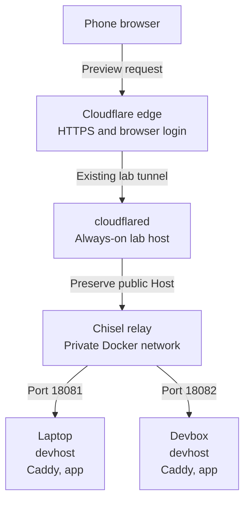

Run `devhost start --remote --detach` to give a stack public HTTPS URLs through an outbound relay. The development machine can sit behind NAT or move between networks. A viewer needs a browser and whatever login your gateway requires; neither a VPN nor a local devhost certificate is needed on the viewing device.

Remote previews require a configured gateway. devhost connects to an existing [Chisel](https://github.com/jpillora/chisel) relay; it does not provision a public service or DNS. A gateway reachable through an existing Cloudflare Tunnel works without a public IP on your development machine or home network.

## How the connection works



Arrows follow a **browser request**, not new inbound connections. The lab's `cloudflared` opens an outbound connection to Cloudflare. Each development machine opens its own outbound Chisel connection to `https://relay.example.com`, which Cloudflare sends through the lab tunnel to the relay's port `8080`. Preview requests return over those established connections. The phone needs no tunnel client, and neither the lab nor the laptop needs an inbound port or public IP.

## Set up a relay with Docker Compose

This example runs the relay and Cloudflare connector together on an always-on Linux Docker host. It uses a domain managed by Cloudflare, a remotely managed Cloudflare Tunnel, and Cloudflare Access for browser login. Substitute your domain for `example.com`. Docker Compose and OpenSSL must be available on the host.

Already have an authenticated gateway and a Cloudflare Tunnel? Run only the `relay` service, attach it to your gateway's existing Docker network, and configure the [same two routes](#configure-public-routes) there. Preserve your existing authentication and tunnel configuration.

### Create the Compose file

Create a private deployment directory outside your application repository:

```bash
umask 077
mkdir -p devhost-relay/relay
cd devhost-relay
chmod 700 relay
printf 'RELAY_UID=%s\nRELAY_GID=%s\n' "$(id -u)" "$(id -g)" > .env
```

Save this as `compose.yaml`:

```yaml
services:
  relay:
    image: ghcr.io/jpillora/chisel:1.12.0
    restart: unless-stopped
    user: "${RELAY_UID:?Set RELAY_UID in .env}:${RELAY_GID:?Set RELAY_GID in .env}"
    read_only: true
    cap_drop: [ALL]
    security_opt: [no-new-privileges:true]
    command:
      - server
      - --host
      - 0.0.0.0
      - --port
      - "8080"
      - --reverse
      - --keyfile
      - /state/server.key
      - --authfile
      - /state/users.json
    volumes:
      - ./relay:/state:ro

  cloudflared:
    image: cloudflare/cloudflared:2026.11.0
    restart: unless-stopped
    user: "${RELAY_UID:?Set RELAY_UID in .env}:${RELAY_GID:?Set RELAY_GID in .env}"
    read_only: true
    cap_drop: [ALL]
    security_opt: [no-new-privileges:true]
    command:
      - tunnel
      - --no-autoupdate
      - run
      - --token-file
      - /run/secrets/tunnel-token
    volumes:
      - ./relay/tunnel-token:/run/secrets/tunnel-token:ro
```

Compose creates a shared network where `cloudflared` can resolve `relay`. There is deliberately no `ports` section: `8080` and each machine's reverse listener remain inside Docker. Both containers run as the user who owns the private files. The Cloudflare image must support [`--token-file`](https://developers.cloudflare.com/cloudflare-one/networks/connectors/cloudflare-tunnel/configure-tunnels/run-parameters/), available since version 2025.4.0; use a maintained pinned version when updating it.

### Create the relay identity and machine credential

Generate the relay's persistent key **once**:

```bash
docker compose run --rm --no-deps relay server --keygen - > relay/server.key
chmod 600 relay/server.key
openssl rand -hex 32
```

Use the random password printed by OpenSSL in `relay/users.json`:

```json
{
  "laptop:REPLACE_WITH_RANDOM_PASSWORD": ["^R:0\\.0\\.0\\.0:18081$"]
}
```

This [Chisel authorization rule](https://github.com/jpillora/chisel/tree/v1.12.0#authentication) permits that machine to open only `0.0.0.0:18081` inside the relay container. Keep the anchors and JSON escaping. Do not use an empty auth file or a wildcard rule.

```bash
chmod 600 relay/users.json
docker compose up -d relay
docker compose logs relay
```

Copy the complete value after `Fingerprint` from the startup log for the machine configuration below. Keep the trailing `=` if present; do not add a `SHA256:` prefix. Back up `server.key` and `users.json` securely. Replacing the key changes the fingerprint and disconnects machines that trust the old identity.

### Configure public routes

1. In Cloudflare Zero Trust, [create a remotely managed tunnel](https://developers.cloudflare.com/cloudflare-one/networks/connectors/cloudflare-tunnel/get-started/create-remote-tunnel/) with connector type **cloudflared**. Save only its tunnel token in `relay/tunnel-token`, using a local editor. Do not put the full install command, the token, or the machine password in `compose.yaml`.
2. Before publishing the preview hostname, [create a self-hosted Access application](https://developers.cloudflare.com/cloudflare-one/access-controls/applications/http-apps/self-hosted-public-app/) for `web--laptop--preview.example.com`. Add an **Allow** policy for the identities that may preview your work, and configure a login method. Preview access includes development tools, so avoid an everyone or bypass policy.
3. Add these published application routes to the tunnel. Leave **HTTP Host Header** unset so requests retain their public hostname.

| Public hostname                    | Service type | Service URL   | Authentication            |
| ---------------------------------- | ------------ | ------------- | ------------------------- |
| `relay.example.com`                | HTTP         | `relay:8080`  | Chisel machine credential |
| `web--laptop--preview.example.com` | HTTP         | `relay:18081` | Access browser login      |

Do not put an interactive Access login on `relay.example.com`: the devhost connector cannot answer it. The relay authenticates that endpoint itself. Leave WebSockets enabled for both routes. Cloudflare's dashboard creates the corresponding DNS records when adding published routes; if managing DNS separately, use [proxied CNAMEs to the tunnel](https://developers.cloudflare.com/cloudflare-one/networks/connectors/cloudflare-tunnel/routing-to-tunnel/dns/). No record should point at your laptop or home IP.

Start the Cloudflare connector:

```bash
chmod 600 relay/tunnel-token
docker compose config --quiet
docker compose up -d
docker compose logs --tail=30 cloudflared
```

The Cloudflare dashboard should show the tunnel connected. A preview route may return `502` until its machine starts a remote stack and opens the reverse listener. `/health` on the relay only checks the relay process; it does not prove a preview works.

### Add apps or another machine

The example publishes one app, `web.localhost`. For another app on the same laptop, add its exact public hostname to the tunnel and Access application, still targeting `relay:18081`.

For a devbox, add a separate `devbox:password` entry to `users.json` with rule `^R:0\\.0\\.0\\.0:18082$`, assign `remotePort = 18082` and `domainSuffix = "--devbox--preview.example.com"` in that machine's configuration, and route its preview hostnames to `relay:18082`. Both machines use the same relay endpoint and fingerprint. Restart the relay after changing credentials; this also revokes established sessions and briefly reconnects other machines.

For automatic routing of arbitrary app names, send wildcard DNS and tunnel traffic through an existing gateway that matches each machine's hostname suffix and forwards it to the assigned port. DNS and Cloudflare Tunnel accept `*.example.com`, **not** `*--laptop--preview.example.com`. A broad wildcard must not override other apps or bypass their authentication; keep `relay.example.com` routed to port `8080`. Exact hostname routes are the simplest standalone setup.

`docker compose down` stops the gateway without deleting the bind-mounted identity and credentials. Keep those files for the next start; do not rerun key generation during upgrades.

## Configure a machine

Add `[remote]` to the machine's [`config.toml`](../../reference/cli/#files-and-directories). Keep it out of project manifests so the same checkout works on different machines.

```toml
[remote]
serverURL = "https://relay.example.com"
credentialFile = "relay.auth"
fingerprint = "REPLACE_WITH_THE_RELAY_SHA256_FINGERPRINT"
remotePort = 18081
domainSuffix = "--laptop--preview.example.com"
localSuffix = ".localhost"
```

The gateway administrator supplies the endpoint, full base64 SHA-256 Chisel fingerprint, assigned reverse port, public hostname suffix, and a separate credential for each machine. Store the supplied `username:password` in `relay.auth` beside `config.toml`, with permissions `0600`. An absolute credential path works too. Credentials stay out of the TOML editor, process arguments, and project files.

For the Compose example, `relay.auth` contains `laptop:` followed by the password you put in `users.json`, on one line. Replace the fingerprint placeholder with the value from `docker compose logs relay`.

| Setting          | Meaning                                                                                                                                     |
| ---------------- | ------------------------------------------------------------------------------------------------------------------------------------------- |
| `serverURL`      | HTTPS endpoint supporting WebSocket upgrades. HTTP is accepted only for loopback testing. Credentials, queries, and fragments are rejected. |
| `credentialFile` | Private file containing one `username:password` value. Relative paths resolve beside `config.toml`.                                         |
| `fingerprint`    | Complete base64 SHA-256 fingerprint of the relay's persistent Chisel key. The connector verifies it in addition to HTTPS.                   |
| `remotePort`     | Reverse listener allocated to this machine, from 1 through 65535.                                                                           |
| `domainSuffix`   | Public suffix assigned to this machine, including its leading dot or hyphen.                                                                |
| `localSuffix`    | Suffix to replace in manifest hostnames. Defaults to `.localhost`.                                                                          |

For this configuration, `web.localhost` becomes `web--laptop--preview.example.com`. The public hostname is selected before service commands and environment templates resolve, so `host` references and `DEVHOST_HOST` describe the hostname the browser uses. Direct service references such as `{{ services.api.url }}` continue to address the local service.

Use flat labels when the gateway certificate covers `*.example.com`: `web--laptop--preview.example.com` fits that wildcard; `web.app--laptop--preview.example.com` needs deeper certificate coverage. Hostnames must end in the configured local suffix or already use the public suffix. Every machine needs its own public suffix, reverse port, and credential.

## Start and stop previews

Start shared Caddy as usual, then opt a stack into remote access:

```bash
devhost caddy start
devhost start --remote --detach
```

Service selections work too: `devhost start --remote --detach web`. The command prints public HTTPS URLs only for routed services that started. Unrouted dependencies remain available to their local consumers.

Detached startup waits for service health, registered routes, and the relay connection. That confirms the connector is ready; verify the printed URL separately to check public DNS, gateway routing, certificates, and browser login. Repeating the command reports the existing remote stack and its URLs. Switching a running stack between local and remote mode requires stopping it first.

For the Compose example, start a stack with a routed service whose manifest host is `web.localhost`. Open `https://web--laptop--preview.example.com` from your phone on mobile data: it should ask for browser login, then show the app. Check in a private browser window that anonymous visitors cannot see the app. If it uses HMR or live devtools, check those after login too; a working HTML response alone does not verify WebSockets.

Use `devhost stop` and `devhost stack restart` normally. Manifest reloads, service selection, and worktree switches update the remote host allowlist along with the stack. Several remote stacks in one state directory share one connector; stopping one leaves the others reachable. Stopping the last removes the connector. Only hosts belonging to active remote stacks are forwarded.

If the connector process itself exits unexpectedly, restart a remote stack to launch a replacement. To replace the shared connector after upgrading devhost, stop all remote stacks before starting them with the new executable.

The connector retries after network interruptions. The public URL stays the same after reconnecting, while open requests and WebSockets may need to reconnect. A sleeping or offline development machine cannot serve its apps. Gateway WebSocket support is required for the tunnel, HMR, and live devtools connections.

Stop the remote stacks before changing `[remote]`, then start them again. Changes to these settings are rejected while a remote stack is running. Project manifest reloads and shared Caddy listener changes remain supported.

## Gateway requirements

The gateway terminates public HTTPS and sends preview requests, preserving the original hostname, to the machine's assigned reverse listener. The Chisel endpoint uses machine authentication; preview hostnames use browser authentication at the gateway. With Cloudflare Tunnel, both endpoints can be reached through outbound connections from the lab.

- Run a compatible Chisel server with reverse forwarding enabled and a persistent server key. devhost embeds Chisel 1.12.0.
- Restrict each machine credential to its exact reverse listener, for example the anchored auth-file rule `^R:0\.0\.0\.0:18081$`. The listener binds to all interfaces inside the relay's network namespace so the gateway proxy can reach it. Keep it on a private network rather than publishing the port on the host.
- Route that machine's public hostname suffix to its assigned listener. Point DNS at the public gateway and supply a certificate covering the resulting names.
- Support WebSocket upgrades on the connector endpoint and preview routes. Apply browser login to the preview routes; an interactive login page on the connector endpoint prevents connection.
- Treat preview access as access to development tools, including terminals and restart controls. The connector rejects changes to the machine configuration editor through remote routes; it is not an authentication service for the rest of the app.

The connector preserves the incoming hostname when proxying to local Caddy and verifies Caddy's certificate with its local root certificate. This lets the gateway's trusted certificate serve the browser while local TLS remains verified.

## Troubleshooting

If startup fails, read the printed stack log and the connector log under `<state>/remote/`. Check the credential file permissions, full fingerprint, assigned port, gateway reverse-forwarding permission, and WebSocket support. A browser login response on the connector endpoint is a routing error.

If the connector starts but the URL fails, check the gateway's hostname rule, DNS, certificate coverage, and browser authentication. If a local-only stack was already running, stop it and restart with `--remote`; repeating a detached start does not change its access mode.
