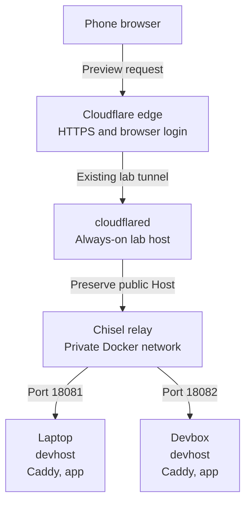

Your agent builds a web app on your laptop or devbox. You open the link on your phone, sign in, and try the actual app—even from a train. Remote previews turn a development server into a regular HTTPS link you can open wherever you have internet.

There is no VPN to install on your phone, no router port to open, and no public IP needed at home or on the laptop. You can review changes while the agent keeps working, without deploying each revision. A laptop can move between Wi-Fi networks: devhost reconnects and keeps the same URL. The machine serving the app must stay awake and online.

Set up one shared gateway and enroll each development machine once. After that, `devhost start --detach` starts the app and prints its preview URL. This guide sets up the gateway, **the laptop, and the devbox** shown below, using your Cloudflare-managed domain and an always-on Docker host you already own. No rented VPS is required. devhost uses a [Chisel](https://github.com/jpillora/chisel) relay and Cloudflare Tunnel to carry the connections; it does not create the gateway or DNS records for you.

## How the connection works



Arrows follow a **browser request**, not new inbound connections. The lab's `cloudflared` opens an outbound connection to Cloudflare. Each development machine opens its own outbound Chisel connection to `https://relay.example.com`, which Cloudflare sends through the lab tunnel to the relay's port `8080`. Preview requests return over those established connections. The phone needs no tunnel client, and neither the lab nor the laptop needs an inbound port or public IP.

## Set up a relay with Docker Compose

This example runs the relay and Cloudflare connector together on an always-on Linux Docker host. It uses a domain managed by Cloudflare, a remotely managed Cloudflare Tunnel, and Cloudflare Access for browser login. Substitute your domain for `example.com`. Docker Compose and OpenSSL must be available on the host.

Run this section on the **always-on lab host**, then [configure both development machines](#configure-a-machine), then [start a preview on each](#start-and-stop-previews). The lab host may also be your devbox; the relay container and the devbox's devhost installation still need their respective setup.

| Where              | What you set up                                    | Address in this example                                 |
| ------------------ | -------------------------------------------------- | ------------------------------------------------------- |
| Always-on lab host | Relay and Cloudflare connector with Docker Compose | `relay.example.com` → relay port `8080`                 |
| Laptop             | devhost, Caddy, and the laptop credential          | `web--laptop--preview.example.com` → relay port `18081` |
| Devbox             | devhost, Caddy, and the devbox credential          | `web--devbox--preview.example.com` → relay port `18082` |

Already have an authenticated gateway and a Cloudflare Tunnel? Run only the `relay` service, attach it to your gateway's existing Docker network, and configure the [same three routes](#configure-public-routes) there. Preserve your existing authentication and tunnel configuration.

### Create the Compose file

Create a private deployment directory outside your application repository:

```bash
umask 077
mkdir -p devhost-relay/relay
cd devhost-relay
chmod 700 relay
printf 'RELAY_UID=%s\nRELAY_GID=%s\n' "$(id -u)" "$(id -g)" > .env
```

Save this as `compose.yaml`:

```yaml
services:
  relay:
    image: ghcr.io/jpillora/chisel:1.12.0
    restart: unless-stopped
    user: "${RELAY_UID:?Set RELAY_UID in .env}:${RELAY_GID:?Set RELAY_GID in .env}"
    read_only: true
    cap_drop: [ALL]
    security_opt: [no-new-privileges:true]
    command:
      - server
      - --host
      - 0.0.0.0
      - --port
      - "8080"
      - --reverse
      - --keyfile
      - /state/server.key
      - --authfile
      - /state/users.json
    volumes:
      - ./relay:/state:ro

  cloudflared:
    image: cloudflare/cloudflared:2026.11.0
    restart: unless-stopped
    user: "${RELAY_UID:?Set RELAY_UID in .env}:${RELAY_GID:?Set RELAY_GID in .env}"
    read_only: true
    cap_drop: [ALL]
    security_opt: [no-new-privileges:true]
    command:
      - tunnel
      - --no-autoupdate
      - run
      - --token-file
      - /run/secrets/tunnel-token
    volumes:
      - ./relay/tunnel-token:/run/secrets/tunnel-token:ro
```

Compose creates a shared network where `cloudflared` can resolve `relay`. There is deliberately no `ports` section: `8080` and each machine's reverse listener remain inside Docker. Both containers run as the user who owns the private files. The Cloudflare image must support [`--token-file`](https://developers.cloudflare.com/cloudflare-one/networks/connectors/cloudflare-tunnel/configure-tunnels/run-parameters/), available since version 2025.4.0; use a maintained pinned version when updating it.

### Create the relay identity and machine credentials

Generate the relay's persistent key **once**:

```bash
docker compose run --rm --no-deps relay server --keygen - > relay/server.key
chmod 600 relay/server.key
```

Run `openssl rand -hex 32` twice to generate **two different passwords**, one for the laptop and one for the devbox. Save them in your password manager, then substitute them in `relay/users.json`:

```json
{
  "laptop:REPLACE_WITH_LAPTOP_PASSWORD": ["^R:0\\.0\\.0\\.0:18081$"],
  "devbox:REPLACE_WITH_DEVBOX_PASSWORD": ["^R:0\\.0\\.0\\.0:18082$"]
}
```

These [Chisel authorization rules](https://github.com/jpillora/chisel/tree/v1.12.0#authentication) let the laptop open only `0.0.0.0:18081` and the devbox only `0.0.0.0:18082` inside the relay container. Keep the anchors and JSON escaping. Do not use an empty auth file, a wildcard rule, or the same credential on both machines.

```bash
chmod 600 relay/users.json
docker compose up -d relay
docker compose logs relay
```

Copy the complete value after `Fingerprint` from the startup log. **Both machines use this same fingerprint** and relay URL, but different credentials and ports. Keep the trailing `=` if present; do not add a `SHA256:` prefix. Back up `server.key` and `users.json` securely. Replacing the key changes the fingerprint and disconnects machines that trust the old identity.

### Configure public routes

1. In Cloudflare Zero Trust, [create a remotely managed tunnel](https://developers.cloudflare.com/cloudflare-one/networks/connectors/cloudflare-tunnel/get-started/create-remote-tunnel/) with connector type **cloudflared**. Save only its tunnel token in `relay/tunnel-token`, using a local editor. Do not put the full install command, the token, or the machine password in `compose.yaml`.
2. Before publishing the preview hostnames, [create a self-hosted Access application](https://developers.cloudflare.com/cloudflare-one/access-controls/applications/http-apps/self-hosted-public-app/) covering **both** `web--laptop--preview.example.com` and `web--devbox--preview.example.com`. You can add both public hostnames to one application or create one application per hostname. Add an **Allow** policy for the identities that may preview your work, and configure a login method. Preview access includes development tools, so avoid an everyone or bypass policy.
3. Add these published application routes to the tunnel. Leave **HTTP Host Header** unset so requests retain their public hostname.

| Public hostname                    | Service type | Service URL   | Authentication            |
| ---------------------------------- | ------------ | ------------- | ------------------------- |
| `relay.example.com`                | HTTP         | `relay:8080`  | Chisel machine credential |
| `web--laptop--preview.example.com` | HTTP         | `relay:18081` | Access browser login      |
| `web--devbox--preview.example.com` | HTTP         | `relay:18082` | Access browser login      |

Do not put an interactive Access login on `relay.example.com`: the devhost connector cannot answer it. The relay authenticates that endpoint itself. Leave WebSockets enabled for all three routes. Cloudflare's dashboard creates the corresponding DNS records when adding published routes; if managing DNS separately, use [proxied CNAMEs to the tunnel](https://developers.cloudflare.com/cloudflare-one/networks/connectors/cloudflare-tunnel/routing-to-tunnel/dns/). No record should point at your laptop or home IP.

Start the Cloudflare connector:

```bash
chmod 600 relay/tunnel-token
docker compose config --quiet
docker compose up -d
docker compose logs --tail=30 cloudflared
```

The Cloudflare dashboard should show the tunnel connected. A preview route may return `502` until its machine starts a remote stack and opens the reverse listener. `/health` on the relay only checks the relay process; it does not prove a preview works.

### Add apps or another machine

The example publishes the service label `web` separately on the laptop and devbox. For another app, add its exact public hostname to the tunnel and Access application, targeting `relay:18081` for the laptop or `relay:18082` for the devbox.

For a third machine, allocate another unused reverse port, a new credential restricted to that port, and a distinct public suffix. Add its protected hostname routes and machine configuration using the same steps below. Restart the relay after changing credentials; this also revokes established sessions and briefly reconnects other machines.

For automatic routing of arbitrary app names, send wildcard DNS and tunnel traffic through an existing gateway that matches each machine's hostname suffix and forwards it to the assigned port. DNS and Cloudflare Tunnel accept `*.example.com`, **not** `*--laptop--preview.example.com`. A broad wildcard must not override other apps or bypass their authentication; keep `relay.example.com` routed to port `8080`. Exact hostname routes are the simplest standalone setup.

`docker compose down` stops the gateway without deleting the bind-mounted identity and credentials. Keep those files for the next start; do not rerun key generation during upgrades.

## Configure a machine

Complete this section **once on the laptop and once on the devbox**. [Install devhost](../../start/install/) on each machine. If Caddy is not already installed, run `devhost caddy download` on each too. On Linux, run `devhost caddy privileged-ports` if port `443` permission has not been configured. You do not need a separate Chisel installation on these machines; devhost includes its connector.

On each machine, create the configuration directory:

```bash
DEVHOST_MACHINE_CONFIG="${DEVHOST_CONFIG_DIR:-${XDG_CONFIG_HOME:-$HOME/.config}/devhost}"
mkdir -p "$DEVHOST_MACHINE_CONFIG"
chmod 700 "$DEVHOST_MACHINE_CONFIG"
```

Edit `config.toml` in that directory. Add the appropriate `[remote]` block below, preserving existing settings such as `[caddy]`; replace an existing `[remote]` block instead of adding a second one. Keep these settings out of project manifests so the same checkout works on different machines.

### On the laptop

```toml
[remote]
serverURL = "https://relay.example.com"
credentialFile = "relay.auth"
fingerprint = "REPLACE_WITH_THE_RELAY_SHA256_FINGERPRINT"
remotePort = 18081
domainSuffix = "--laptop--preview.example.com"
```

Create `relay.auth` beside `config.toml` using a local editor. Its single line is `laptop:` followed by the **laptop password** from the relay's `users.json`.

### On the devbox

```toml
[remote]
serverURL = "https://relay.example.com"
credentialFile = "relay.auth"
fingerprint = "REPLACE_WITH_THE_RELAY_SHA256_FINGERPRINT"
remotePort = 18082
domainSuffix = "--devbox--preview.example.com"
```

Create this machine's own `relay.auth` beside its `config.toml`. Its single line is `devbox:` followed by the **devbox password** from `users.json`. Do not copy the laptop's credential file onto the devbox.

### Finish on both machines

Replace the fingerprint placeholder in both configurations with the value from `docker compose logs relay`, and substitute your actual domain in `serverURL` and `domainSuffix`. On each machine, make its credential file private:

```bash
chmod 600 "$DEVHOST_MACHINE_CONFIG/relay.auth"
```

If someone else operates the gateway, obtain the endpoint, fingerprint, assigned port, suffix, and credential from them. An absolute credential path works too. Credentials stay out of the TOML editor, process arguments, and project files.

Keep service identity in the project: use `host = "web"` or aliases such as `host = ["web", "admin"]`. Machine configuration supplies the suffix. You can manage that configuration through your dotfiles or another configuration tool; devhost still reads the location selected above. Each machine needs its own enrollment and credential.

| Setting          | Meaning                                                                                                                                     |
| ---------------- | ------------------------------------------------------------------------------------------------------------------------------------------- |
| `serverURL`      | HTTPS endpoint supporting WebSocket upgrades. HTTP is accepted only for loopback testing. Credentials, queries, and fragments are rejected. |
| `credentialFile` | Private file containing one `username:password` value. Relative paths resolve beside `config.toml`.                                         |
| `fingerprint`    | Complete base64 SHA-256 fingerprint of the relay's persistent Chisel key. The connector verifies it in addition to HTTPS.                   |
| `remotePort`     | Reverse listener allocated to this machine, from 1 through 65535.                                                                           |
| `domainSuffix`   | Public suffix assigned to this machine, including its leading dot or hyphen.                                                                |

`web` becomes `web--laptop--preview.example.com` on the laptop and `web--devbox--preview.example.com` on the devbox. The public hostname is selected before service commands and environment templates resolve, so `host` references and `DEVHOST_HOST` describe the hostname the browser uses. Direct service references such as `{{ services.api.url }}` continue to address the local service.

Use flat labels when the gateway certificate covers `*.example.com`: `web--laptop--preview.example.com` fits that wildcard; `web.app--laptop--preview.example.com` needs deeper certificate coverage. Remote mode requires a single DNS label and rejects dotted, full, and already-public hostnames. Every machine needs its own public suffix, reverse port, and credential.

## Migrate full hostnames to portable labels

Replace `host = "web.localhost"` with `host = "web"` in the project manifest, including aliases. Remote mode rejects full hostnames rather than stripping a suffix. Explicit full hostnames remain valid for local-only routing with `--local`.

Remove `remote.localSuffix` from machine configuration. For the default local URL `web.localhost`, no replacement setting is needed. If this machine needs a custom local suffix, place `domainSuffix` **before any table header**, at the top level of `config.toml`:

```toml
domainSuffix = "--devbox.example.com"

[remote]
# Keep this machine's relay settings here.
```

Then `devhost start --local` resolves `web` to `web--devbox.example.com`; ordinary startup uses `[remote].domainSuffix` when enrolled. DNS for a custom local suffix must resolve to the development machine. Stop running stacks before changing routing configuration.

## Start and stop previews

On **each machine**, open a repository with a `devhost.toml` that routes a service with `host = "web"`. For a standalone connectivity check, create an empty directory on each machine with these two files:

```toml title="devhost.toml"
name = "remote-preview-demo"

[services.web]
serve = "public"
host = "web"
```

```html title="public/index.html"
<!doctype html>
<title>Remote preview</title>
<h1>Remote preview works</h1>
```

Create the `public` directory before saving the HTML file. From beside `devhost.toml`, start shared Caddy, then start the stack:

```bash
devhost caddy start
devhost start --detach
```

Run those commands on **both the laptop and the devbox**. Service selections work too: `devhost start --detach web`. The command prints public HTTPS URLs only for routed services that started. Unrouted dependencies remain available to their local consumers.

| Started on | Expected preview URL with the example domain |
| ---------- | -------------------------------------------- |
| Laptop     | `https://web--laptop--preview.example.com`   |
| Devbox     | `https://web--devbox--preview.example.com`   |

Copy the URLs printed by devhost; they reflect your actual domain, service names, and route paths. A configured `[remote]` selects remote routing automatically; without it, startup uses local routing. Existing `just run` wrappers need no new remote flag. Use `--remote` (`-r`) to require enrollment explicitly, or `--local` (`-l`) to force local routing; the two flags are mutually exclusive. Invalid configuration or a failed relay connection stops startup with an error, without silently falling back to local URLs.

Detached startup waits for service health, registered routes, and the relay connection. That confirms the connector is ready; verify the printed URL separately to check public DNS, gateway routing, certificates, and browser login. Repeating the command reports the existing remote stack and its URLs. Switching a running stack between local and remote mode requires stopping it first.

Open **both printed URLs** from your phone on mobile data: sign in when prompted, then confirm each shows the expected app (or “Remote preview works” for the sample). Check each in a private browser window to confirm anonymous visitors cannot see it. If your app uses HMR or live devtools, check those after login too; a working HTML response alone does not verify WebSockets. Disconnect the laptop's Wi-Fi and reconnect on another network, then reopen its same URL after the connector reconnects. The devbox preview should remain available throughout.

Use `devhost stop` and `devhost stack restart` normally. Manifest reloads, service selection, and worktree switches update the remote host allowlist along with the stack. Several remote stacks in one state directory share one connector; stopping one leaves the others reachable. Stopping the last removes the connector. Only hosts belonging to active remote stacks are forwarded.

If the connector process itself exits unexpectedly, restart a remote stack to launch a replacement. To replace the shared connector after upgrading devhost, stop all remote stacks before starting them with the new executable.

The connector retries after network interruptions. The public URL stays the same after reconnecting, while open requests and WebSockets may need to reconnect. A sleeping or offline development machine cannot serve its apps. Gateway WebSocket support is required for the tunnel, HMR, and live devtools connections.

Stop affected stacks before changing machine routing settings (`domainSuffix` or `[remote]`), then start them again. Active routing settings cannot change through hot reload. Detached starts, manifest reloads, and stack restarts preserve the selected mode and suffix. Project manifest reloads and shared Caddy listener changes remain supported.

## Gateway requirements

The gateway terminates public HTTPS and sends preview requests, preserving the original hostname, to the machine's assigned reverse listener. The Chisel endpoint uses machine authentication; preview hostnames use browser authentication at the gateway. With Cloudflare Tunnel, both endpoints can be reached through outbound connections from the lab.

- Run a compatible Chisel server with reverse forwarding enabled and a persistent server key. devhost embeds Chisel 1.12.0.
- Restrict each machine credential to its exact reverse listener, for example the anchored auth-file rule `^R:0\.0\.0\.0:18081$`. The listener binds to all interfaces inside the relay's network namespace so the gateway proxy can reach it. Keep it on a private network rather than publishing the port on the host.
- Route that machine's public hostname suffix to its assigned listener. Point DNS at the public gateway and supply a certificate covering the resulting names.
- Support WebSocket upgrades on the connector endpoint and preview routes. Apply browser login to the preview routes; an interactive login page on the connector endpoint prevents connection.
- Treat preview access as access to development tools, including terminals and restart controls. The connector rejects changes to the machine configuration editor through remote routes; it is not an authentication service for the rest of the app.

The connector preserves the incoming hostname when proxying to local Caddy and verifies Caddy's certificate with its local root certificate. This lets the gateway's trusted certificate serve the browser while local TLS remains verified.

## Troubleshooting

If startup fails, read the printed stack log and the connector log under `<state>/remote/`. Check the credential file permissions, full fingerprint, assigned port, gateway reverse-forwarding permission, and WebSocket support. A browser login response on the connector endpoint is a routing error.

If the connector starts but the URL fails, check the gateway's hostname rule, DNS, certificate coverage, and browser authentication. If a local-only stack was already running, stop it and start it again using the configured relay; repeating a detached start does not change its access mode.
