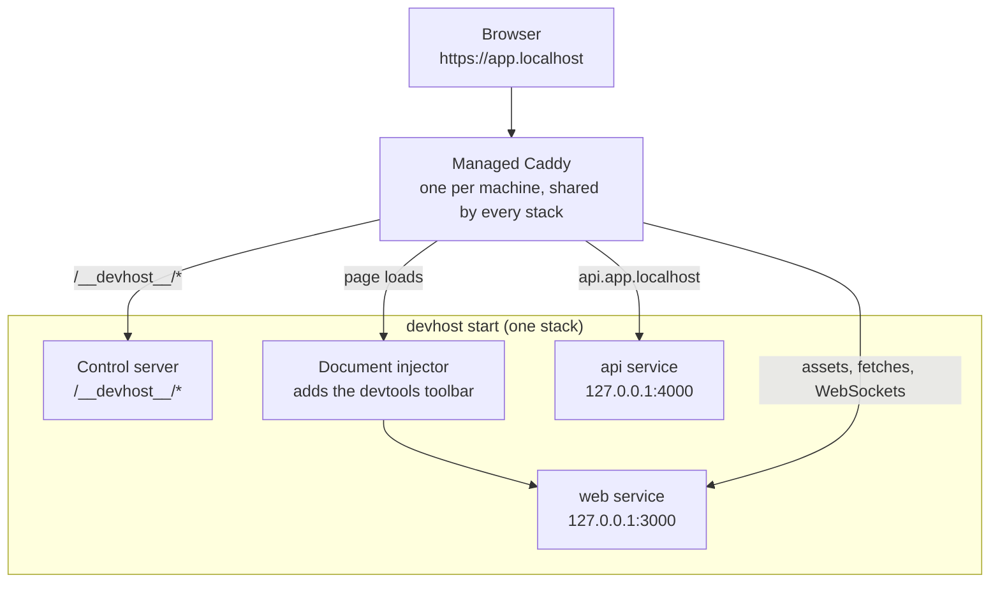

devhost runs your development services and puts each one behind a real HTTPS hostname, such as `https://app.localhost`, instead of `localhost:3000`. This page explains the moving parts and the words the rest of the docs use.

## The pieces

1. **The manifest.** `devhost.toml` lists your services: the command that starts each one, its port, its hostname, and what it depends on.
2. **The stack.** `devhost start` reads the manifest, starts the services in dependency order, waits for their health checks, and supervises them until you stop it.
3. **Managed Caddy.** One [Caddy](https://caddyserver.com/) server on your machine terminates HTTPS for every stack. Each stack adds routes for its hostnames while it runs and removes them when it stops.
4. **Devtools (optional).** When a browser loads a page, devhost injects a small toolbar with service status, logs, restarts, and a chat with your coding agent. Everything else goes straight to your app, so assets, HMR, and WebSockets behave as usual.

devhost does not manage DNS, containers, or your browser. Your hostnames must already resolve to this machine; names under `.localhost` do so without any setup.

## Words used in these docs

| Term             | Meaning                                                                                                                       |
| ---------------- | ----------------------------------------------------------------------------------------------------------------------------- |
| Manifest         | A `devhost.toml` file. The **root manifest** is the one you start; it can pull in **included manifests**.                     |
| Stack            | One running `devhost start` and the services it supervises. A stack is identified by the path of its root manifest.           |
| Service          | One entry under `[services.<name>]`.                                                                                          |
| Routed service   | A service with a `host`, reachable through Caddy at `https://<host>`.                                                         |
| Managed service  | A service devhost starts and stops: a foreground `command`, or a background daemon with `start` and `stop` commands.          |
| External service | A service with `managed = false`. devhost routes to it and checks its health, but something else runs it.                     |
| Primary service  | The service marked `primary = true`, or else the first service in the manifest. Actions that need one default service use it. |
| Health check     | How devhost decides a service is ready: a TCP connection, an HTTP response, or a live process.                                |
| Recovery page    | The page devhost shows at a service's hostname while it starts, after it exits, or when it fails.                             |
| Checkout         | A Git worktree of a repository your services run from. The toolbar can switch the stack between checkouts.                    |
| Config file      | `config.toml`, the machine-wide settings every stack shares, such as Caddy's ports.                                           |
| State directory  | Where devhost keeps its runtime records and Caddy's data, `~/.local/state/devhost` by default.                                |

## One machine, many stacks

You can run a stack for each project at the same time. They share one Caddy and one config file, and devhost keeps them apart:

- A hostname belongs to one stack at a time. A second stack that claims it fails to start and names the owner.
- A fixed port belongs to one stack at a time. `port = "auto"` picks a free port instead.
- A manifest file belongs to one stack at a time, including manifests pulled in through `includes`.

`https://devhost.localhost/` (customizable with `[caddy].stackDirectoryHost` in `config.toml`) lists every running stack with links to its services. See [Running stacks in the browser](../../guides/stack-lifecycle/#running-stacks-in-the-browser).

## Where to go next

- [Run a stack](../../guides/stack-lifecycle/): start, stop, and start part of a stack.
- [Route apps over HTTPS](../../guides/managed-caddy/): hostnames, paths, and certificates.
- [Serve files or a port](../serve/): HTTPS for a folder or an already running server, without a manifest.
- [Manifest reference](../../reference/devhost-example/): every setting, with defaults.
